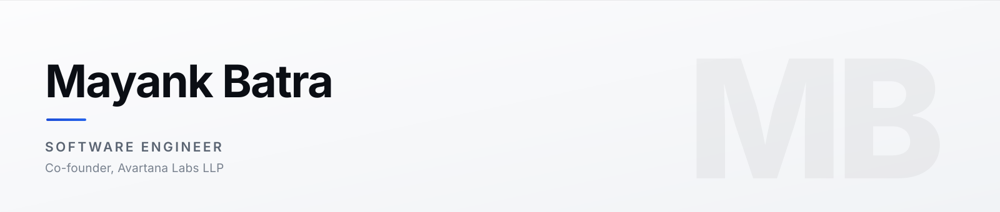

<picture>
  <source media="(prefers-color-scheme: dark)" srcset=".github/assets/hero-dark.svg">
  
</picture>

I'm a software engineer and co-founder of **[Avartana Labs LLP](https://www.avartanalabs.com/)**. I build local-first systems, tooling for AI coding agents, and product interfaces that hold up under real use.

> I'd rather publish a caveat than a number I can't reproduce.

<p>
  <a href="#selected-work">Selected work</a> &nbsp;·&nbsp;
  <a href="#how-i-work">How I work</a> &nbsp;·&nbsp;
  <a href="#stack">Stack</a> &nbsp;·&nbsp;
  <a href="https://www.avartanalabs.com/">Avartana Labs</a> &nbsp;·&nbsp;
  <a href="https://github.com/Ghost-9?tab=repositories">All repositories</a>
</p>

---

## What I work on

Three things, in roughly this order of depth:

**Agent and developer tooling.** Resident daemons, MCP servers, and editor/agent extensions — the plumbing that makes a coding agent fast and predictable instead of clever and unreliable. Mostly Rust for the hot paths, TypeScript for the surfaces the harnesses actually speak.

**Local-first data and retrieval.** Keeping the human-readable source of truth canonical and the index disposable. Search that answers from local storage, degrades visibly when it can't, and fails closed rather than quietly shipping private text to a remote model.

**Product surfaces.** Cross-platform mobile and web interfaces — Flutter, SwiftUI, Next.js — written to ship, not to demo.

---

## Selected work

### [pi-ultrasearch](https://github.com/Ghost-9/pi-ultrasearch)
*Resident filesystem search for coding agents.*

Agents lose real time spawning `find`, `rg`, and `grep -rn` subprocesses. This keeps a resident path + trigram index behind a UNIX socket and answers those queries in-process, scoped to the workspace. Ships as a Pi Agent extension, a CLI, and a stdio MCP server.

`Rust daemon` · `TypeScript` · `MCP` · `AGPL-3.0`

Its README opens with a note that earlier versions quoted best-case warm-cache numbers as if they were session-level figures, and claimed a CI that did not exist — and the current figures are each labelled with their measurement scope. The open issues are mostly measurement-integrity findings I filed against myself: an integrity pin that covers 15 of 41 measurement files, a baseline suite that moved when re-run. That audit trail is the part I'd point a reviewer at.

---

### [pi-tern](https://github.com/Ghost-9/pi-tern)
*Tern terminal integration for the pi coding agent.*

Adds rich surfaces to a terminal agent without patching it: MCP-style handshake, native Mermaid rendering, WKWebView driving, pane capture, session mirroring. The extension deliberately never writes TSP frames — pi's renderer uses synchronized multi-write output transactions, and a second writer tears them.

`TypeScript` · `MIT` · `published on npm`

Every feature is labelled `stable` or `experimental` in a status table, and the native-rendering path is documented as the special case rather than the default — it runs stock pi in a shell block, outside Tern, or under `-p`. 136 tests pass on `node --test`; `tsc --noEmit` is clean.

---

### [local-memory-fabric](https://github.com/Ghost-9/local-memory-fabric) — Engram
*A local-first memory engine for coding agents.*

Markdown stays the canonical, human-editable source; SQLite/FTS5 is a disposable index that can be rebuilt at any time. Rust engine, TypeScript extension, BM25 lexical retrieval, and a fail-closed DLP layer that redacts credential classes before an excerpt can leave the machine.

`Rust` · `TypeScript` · `SQLite FTS5` · `AGPL-3.0`

The interesting part is not the latency table. It's `bench/`, which exists so a performance claim can be re-checked by someone who isn't me: alternating A/B arms, medians rather than means, output-equivalence checks before any win is claimed, and a recorded case where the original hypothesis was refuted by the measurements. The changelog is written the same way, including the gates that still do not run.

---

### Product surfaces

Interfaces I've designed and shipped. Each link is a live build, not a screenshot.

- **[Furniture-App-UI](https://github.com/Ghost-9/Furniture-App-UI)** — gesture-driven catalog with responsive multi-device viewports. [`live demo`](https://ghost-9.github.io/Furniture-App-UI/) · Flutter, MIT
- **[employee-ledger](https://github.com/Ghost-9/employee-ledger)** — offline-first team directory on Sembast with BLoC. [`live PWA`](https://ghost-9.github.io/employee-ledger/) · Flutter Web
- **[Coffee-App](https://github.com/Ghost-9/Coffee-App)** — OLED-tuned ordering flow, Material 3. [`live demo`](https://ghost-9.github.io/Coffee-App/) · Flutter, MIT
- **[caretaker](https://github.com/Ghost-9/caretaker)** — healthcare concierge site, editorial layout. [`live site`](https://caretaker-nine.vercel.app) · Next.js
- **[Weather-App](https://github.com/Ghost-9/Weather-App)** — native iOS/macOS weather UI with diurnal theming. · SwiftUI, MIT

---

## How I work

These are habits, not slogans — each is visible in the repositories above.

**Measure so someone else can re-run it.** A benchmark that lives in my `/tmp` is not evidence. The harness gets committed, with its method and its failure modes.

**Separate "faster" from "correct."** A fast error response is not a fast search. Output equivalence gets checked before a speedup gets claimed.

**Label the maturity.** `stable`, `experimental`, `planned`, and `known broken` are different states, and the README says which one you're looking at.

**Caveats go in the document, not the changelog footnote.** If a gate doesn't run or a metric is `n=5`, that belongs where a reader will see it.

**Fail closed.** When unsure whether something is safe to send, don't send it.

**Pin the toolchain.** A floating compiler turns a newly published lint into a red build with no code change. Green should mean the same thing on my machine and in CI.

---

## Stack

Working fluency, not a claim of mastery in all of it:

```
Systems    Rust · SQLite / FTS5 · UNIX sockets · POSIX shared memory
Agents     MCP · Pi Agent extensions · T3 Code · tool dispatch
Frontend   TypeScript · React · Next.js · Tailwind CSS
Mobile     Flutter · Dart · Swift · SwiftUI
Tooling    Cargo · Node · GitHub Actions · Xcode · Android Studio
```

---

## Company

I co-founded **[Avartana Labs LLP](https://www.avartanalabs.com/)**, where we design and ship software products — see the [organization on GitHub](https://github.com/Avartanalabs) for what's public there.

Most of my work day is product architecture, delivery, and keeping a small team's engineering quality high. The repositories above are the parts I can show.

---

<p align="center">
  <sub><a href="https://www.avartanalabs.com/">avartanalabs.com</a> &nbsp;·&nbsp; <a href="https://github.com/Ghost-9">github.com/Ghost-9</a></sub>
</p>
